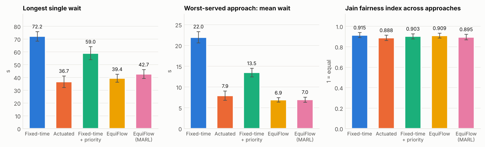
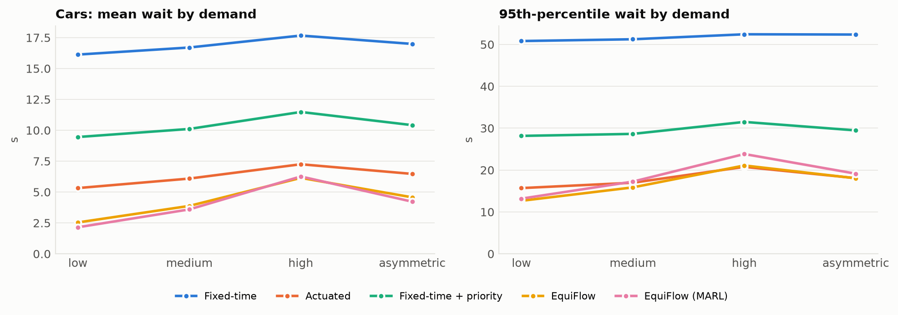
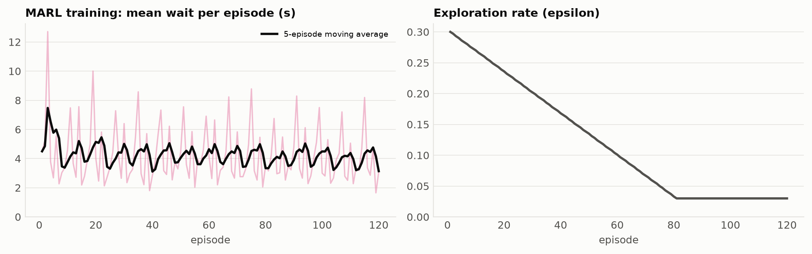
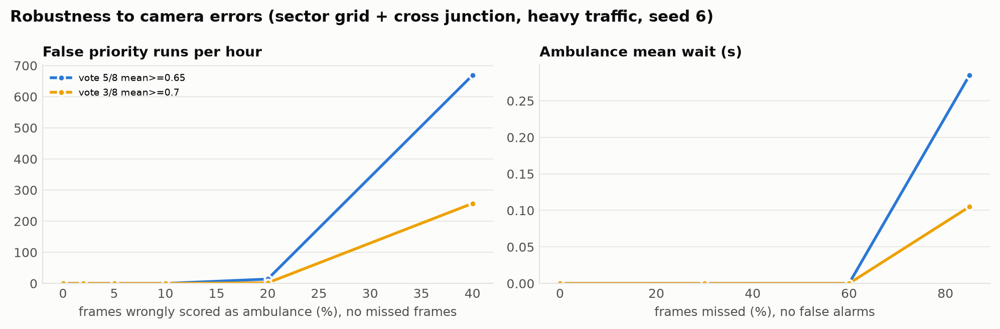

# EquiFlow: results, failure cases and limitations

Everything here is produced by scripts in the repository. Numbers come from the CSV files named in each
section; nothing was typed in by hand. Regenerate with:

```bash
cd sumo
python run_matrix.py        # 1 400 one-hour SUMO runs (~20 min on 10 cores) -> results/heldout/
python aggregate.py         # statistics -> results/heldout/RESULTS_TABLES.md (all tables, more than shown here)
python run_matrix.py --scenarios emergency --out results/stress \
    --controllers equiflow equiflow-recovery equiflow-recovery-order equiflow-recovery-v1 fixed+preempt actuated
python aggregate.py --dir results/stress                  # fair-recovery stress test
python run_robustness.py --jobs 10 --seed 6 --fp 0 0.02 0.05 0.1 0.2 0.4 --k 5 --mean-min 0.65
python run_robustness.py --jobs 10 --seed 6 --fp 0 0.02 0.05 0.1 0.2 0.4 --k 3 --mean-min 0.70
python benchmark.py         # controller timing
python make_plots.py        # docs/figures/
python latex_tables.py      # docs/latex/results_tables.tex
cd ../Projects
python make_split_manifest.py --data crops   # dataset split manifest + leakage check
python eval_detector.py --data crops         # classifier on the test split + GPU latency -> runs/eval_test*/
python train_cls_v5.py --compare cls_v4-2 cls_v5_base cls_v5_img128 cls_v5_os2   # val comparison
python track_pipeline.py test1 test2 ...     # tracking on the Islamabad videos (GPU)
python score_tracking.py                     # -> tracking_out/tracking_scores.md
python tune_tracking.py dump && python tune_tracking.py sweep   # vote re-tuning -> tracking_out/tune/
```

## 1. Set-up

- **Networks:** the 6 signalised Islamabad junction types in `sumo/` (cross, T, five-way, six-way, sector grid,
  diamond), each at 4 demand levels (low, medium, high, asymmetric), one simulated hour each.
- **Seeds 6–10, held out.** The MARL controller was trained on seeds 1–5, so no evaluation run was seen in
  training (mid-report Section 7.5). Every controller runs the same 120 network × demand × seed combinations.
- **Controllers:** SUMO fixed-time; SUMO actuated (the strong adaptive baseline); fixed-time + ambulance
  priority without recovery (the "emergency-only preemption" baseline of Section 7.2); EquiFlow; EquiFlow
  with the MARL base controller; ablations (no green extension, no gap-out, the first tail settings) and the
  optional parts switched back on (three fair-recovery rules, two green-corridor rules).
- **Iteration 2b** (this version) added actuated-style green extension, tail-wait tuning of the adaptive
  controller, a just-in-time green corridor, a re-order-only recovery rule, the "vehicles held by an ambulance"
  metric, a recovery stress scenario and a retrained MARL policy; switched fair recovery and the corridor off by
  default because neither helped; and re-ran every controller. Tuning used seeds 1–2 only.
- **Ambulances** are detected by a virtual camera per approach with the 5-of-8 vote (the backend default);
  priority starts only after confirmation. The live camera pipeline now uses 3 of 8 (Section 6).
- **Statistics:** mean ± 95% confidence interval over runs. "Paired" comparisons subtract two controllers on
  the *same* network, demand and seed, which removes the large differences between networks.

Source: `sumo/results/heldout/` (`summary_stats.csv`, `paired.csv`, `by_scenario.csv`, `marl_heldout.csv`,
`run_manifest.csv` holds the configuration and software versions behind every run).

## 2. Main results


EquiFlow below is the recommended configuration since Iteration 2b: adaptive base controller (waiting-time weight
0.3), ambulance priority, gap-out and green extension; **fair recovery and the green corridor off** (Section 3).

| | Fixed-time | Actuated | Fixed + priority | **EquiFlow** | EquiFlow (MARL) |
|---|---|---|---|---|---|
| Ambulance mean wait (s) | 13.75 ± 1.16 | 7.42 ± 1.31 | 0.19 ± 0.08 | **0.10 ± 0.06** | 0.10 ± 0.05 |
| Ambulance travel time (s) | 59.14 ± 2.42 | 52.75 ± 2.40 | 43.19 ± 2.21 | **42.68 ± 2.22** | 42.54 ± 2.22 |
| Car mean wait (s) | 16.87 ± 1.02 | 6.28 ± 1.01 | 10.36 ± 0.86 | **4.28 ± 0.57** | 4.05 ± 0.53 |
| 95th-percentile wait (s) | 51.71 ± 1.61 | 17.87 ± 2.13 | 29.44 ± 1.69 | **16.91 ± 1.31** | 18.34 ± 1.65 |
| Longest single wait (s) | 72.17 ± 3.72 | 36.71 ± 4.45 | 57.69 ± 5.03 | **39.84 ± 3.34** | 42.69 ± 3.72 |
| Worst approach, mean wait (s) | 21.98 ± 1.37 | 7.95 ± 1.10 | 13.40 ± 1.01 | **5.63 ± 0.59** | 5.49 ± 0.58 |
| Jain index across approaches | 0.915 | 0.888 | 0.903 | **0.878** | 0.878 |
| Vehicles held by an ambulance, mean wait (s) | 36.17 ± 1.16 | 12.39 ± 1.37 | 25.22 ± 1.63 | **19.64 ± 1.35** | 19.55 ± 1.43 |
| Detection to green (s) | – | – | 2.57 | **2.37** | 2.39 |
| Runs | 120 | 120 | 120 | 120 | 120 |

"Vehicles held by an ambulance" (approach-level fairness): ordinary vehicles that were stopped at a junction while
a real ambulance was within camera range on another of its approaches, i.e. the vehicles priority can delay. It is
ground truth, so it is measured the same way for controllers that give no priority.

**What this shows**

1. **Ambulances practically stop waiting at signals**: 13.8 s → 0.1 s against fixed-time and 7.4 s → 0.1 s
   against actuated; ambulance travel time drops by 16.5 s (28%) against fixed-time and 10.1 s (19%) against
   actuated (EquiFlow faster in 100% of paired runs).
2. **Ordinary traffic waits less than with actuated control, with no significant cost in the tail.** Car wait is
   2.00 ± 0.61 s lower than actuated (better in 68% of paired runs; Iteration 2: 0.90 s, 38%), the worst-served
   approach waits 2.3 s less, and the 95th-percentile wait (−0.96 ± 1.32 s), the longest single wait
   (+3.1 ± 3.3 s) and the Jain index (−0.01) are all statistically level with actuated.
3. **The vehicles an ambulance holds pay for its priority.** They wait 19.6 s on average, against 12.4 s with
   actuated control (which never holds them), but 5.6 s less than with fixed-time plus simple priority and 17.4 s
   less than with fixed-time.
4. **Heavy demand: the tail gap to actuated is closed.** Car wait 6.15 vs 7.25 s; 95th-percentile wait 21.10 vs
   20.76 s, a paired difference of +0.33 ± 2.87 s, not significant (Iteration 2: +1.68 s; first Iteration 2b
   round: +1.17 s). EquiFlow still loses 1 s more per phase change than SUMO's actuated plans (3 s yellow + 2 s
   all-red against 4 s yellow, no all-red), kept for safety.




## 3. What each part contributes (paired on identical runs)


EquiFlow minus the variant; negative = EquiFlow lower (better for waits). n.s. = 95% CI includes zero.

| Variant of EquiFlow | Car mean wait | 95th-percentile | Longest wait | Held by an ambulance (p95) | Verdict |
|---|---|---|---|---|---|
| **Without green extension** | −1.33 ± 0.18 s (better in 95%) | −1.16 ± 0.38 s | +1.36 s (n.s.) | −0.45 s (n.s.) | **Keep**: large gain, no significant tail cost now |
| **Without gap-out** | −1.15 ± 0.18 s (99%) | −2.11 ± 0.27 s | −2.37 ± 1.94 s | −3.07 ± 2.07 s | **Keep**: better on every measure |
| **First tail settings** (wait weight 0.1, extension wait cap 40 s) | +0.32 ± 0.13 s | −0.44 ± 0.29 s | **−4.35 ± 2.09 s** | −1.52 ± 1.27 s | New settings trade 0.3 s of car wait for shorter tails |
| **+ recovery, queue-sized greens** | −0.08 ± 0.07 s | −0.26 ± 0.21 s | +0.06 s (n.s.) | −1.33 s (n.s.) | Recovery off is as good or better |
| **+ recovery, re-order only** (new) | −0.05 s (n.s.) | −0.25 ± 0.18 s | −0.47 s (n.s.) | −1.51 s (n.s.) | Neutral at best: no benefit |
| **+ recovery, first rule** | −0.14 ± 0.09 s | −0.74 ± 0.34 s | −2.15 ± 1.81 s | −2.10 ± 1.37 s | Worst of the three |

- **Green extension** (actuated-style): a base green that reaches its planned length keeps going while its
  approach is still the busiest, up to 45 s, and only while no other queued approach has waited 30 s; never
  during priority or recovery. With the tighter 30 s wait cap and a higher waiting-time weight (0.3) in the
  adaptive controller, the longest-wait cost it had in the first round (+6.6 s) is gone (+1.4 s, n.s.). The
  settings were chosen on tuning seeds 1–2.

### 3.1 Green corridor (sector grid and diamond only, 40 paired runs)

| EquiFlow (no corridor) minus | Ambulance travel | 95th-percentile | Held by an ambulance (mean) | Detection to green |
|---|---|---|---|---|
| + just-in-time corridor (new) | +0.04 s (n.s.) | −0.37 ± 0.32 s | **−2.43 ± 1.31 s** | +0.57 ± 0.13 s |
| + corridor, 25 s ETA (Iteration 2 rule) | +0.08 s (n.s.) | −0.71 ± 0.47 s | **−6.76 ± 1.92 s** | −0.13 s (n.s.) |

The corridor turns the downstream signal green a little earlier (detection to green 0.57 s sooner with the
just-in-time rule), but **ambulance travel time does not change** on these networks (junctions 300 m apart), while
the vehicles it holds wait longer. The just-in-time rule removes most of the first rule's cost (−4.3 s for held
vehicles), but no corridor is better still. **The corridor is therefore off by default** (`sumo.corridor: false`);
it remains available for junctions closer together than the camera range.

### 3.2 Fair-recovery stress test (heavy traffic, ~40 ambulances per hour)

Source: `sumo/results/stress/` (`run_matrix.py --scenarios emergency`, 6 networks × seeds 6–10, 30 runs each).

| | Actuated | Fixed + priority | **EquiFlow** | + recovery (queue) | + recovery (re-order) | + recovery (first rule) |
|---|---|---|---|---|---|---|
| Car mean wait (s) | 7.19 | 11.09 | **6.53** | 6.74 | 6.57 | 7.07 |
| 95th-percentile wait (s) | 20.53 | 33.93 | **21.80** | 23.06 | 22.03 | 25.84 |
| Held by an ambulance, p95 (s) | 27.93 | 46.84 | **37.29** | 36.76 | 35.88 | 39.65 |
| Ambulance mean wait (s) | 7.67 | 0.15 | **0.13** | 0.12 | 0.14 | 0.18 |

Paired against EquiFlow without recovery: queue-sized recovery raises the 95th-percentile wait by
1.26 ± 0.86 s (significant); the re-order variant changes nothing significantly (95th percentile +0.22 s, held
vehicles' p95 −1.4 s, both n.s.); the first rule is clearly worse (95th percentile +4.03 ± 1.53 s).
**Conclusion: re-ordering removes the harm of fair recovery but not its lack of benefit.** An adaptive base
controller that already serves the longest-waiting busy approach next leaves nothing for a separate recovery phase
to fix, even with frequent priority. Fair recovery is therefore **off by default** (`preempt.recovery: false`;
the scripted FR-09 scenario switches it on to verify the logged recovery sequence), with `recovery_mode: order`
as the recommended mode where it is wanted.

## 4. MARL controller



Retrained from scratch for 120 episodes on seeds 1–5 with the final junction settings (recovery and corridor off,
green extension on) and a reward that also charges every halted vehicle that has waited more than 20 s.

| MARL minus adaptive, held-out seeds | Iteration 2 | Iteration 2b |
|---|---|---|
| Car mean wait (s) | 0.00 ± 0.17 | **−0.23 ± 0.18** (better) |
| 95th-percentile wait (s) | +1.85 ± 0.56 | **+1.43 ± 0.55** (worse) |
| Longest single wait (s) | +3.2 | +2.85 ± 1.97 (worse) |
| Vehicles held by an ambulance, p95 (s) | – | +2.25 ± 2.23 (worse) |

MARL now beats the heuristic on car wait, but the adaptive controller's own tail tuning (Section 3) moved further
than MARL did, so the heuristic still has the better 95th-percentile and longest waits, especially under heavy
demand (21.1 vs 23.8 s). The gap is similar on network/demand combinations MARL was trained on and ones it never
saw (`marl_heldout.csv`), so it is not over-fitting. The adaptive controller stays the default.

## 5. Robustness to camera errors



Source: `sumo/results/robustness.csv` (cross junction and sector grid, heavy traffic, seed 6), for both votes: the
SUMO / backend default (5 of 8, mean ≥ 0.65) and the live camera vote re-tuned for `cls_v5_img128` (3 of 8,
mean ≥ 0.70).

| Frames wrongly scored as ambulance | 0–10% | 20% | 40% |
|---|---|---|---|
| False priority runs per hour, 5 of 8 | 0 | 8, 20 | 386, 952 |
| False priority runs per hour, **3 of 8** | 0 | **0, 4** | **145, 369** |

- **The live 3-of-8 vote is more robust, not less.** Its stricter mean-score threshold (0.70) matters more than
  the lower vote count.
- The system needs a classifier whose per-frame false-alarm rate on real traffic stays well below 20%. The test
  split shows 0.9% (`cls_v5_img128`), so there is a wide margin, but real video (test5) is harder than crops.
- **Missed frames barely matter:** with 85% of frames missed, ambulances wait at most 0.57 s (5 of 8) and 0.21 s
  (3 of 8).

## 6. Ambulance classifier and tracking on real video

### 6.1 Dataset check

Source: `Projects/split_report.md`, `split_duplicates.csv` (`make_split_manifest.py`).

- 32 593 crops (train 25 688, val 3 184, test 3 721) listed with SHA-1 and dHash.
- **The test split has no exact copy of a training image.** 134 test crops (3.6%) are near duplicates of a
  training crop, all with the same label.
- **Removed:** 4 validation crops labelled ambulance that were copies (`- Copy.jpg`) of training crops labelled
  other vehicle, and 35 duplicate `- Copy.jpg` files inside train. The 4 mislabelled copies had all been counted
  as missed ambulances: removing them raised `cls_v4-2`'s val recall from 91.0% to 91.8%.
- Left: 19 same-label exact duplicates between val and train.

### 6.2 Retraining (val split; chosen here, then tested once)

Source: `Projects/runs/<run>/val_metrics.json` (`train_cls_v5.py`). yolo26n-cls, 30 epochs, RTX 4050.

| Run | Change | PR-AUC | Recall | Precision | F1 | False alarms |
|---|---|---|---|---|---|---|
| cls_v4-2 | mid-report model | 0.973 | 91.8% | 95.6% | 0.937 | 0.7% |
| cls_v5_base | same settings, cleaned data | 0.975 | 91.8% | 94.5% | 0.931 | 0.8% |
| **cls_v5_img128** | input 128 px | **0.979** | 92.8% | 95.0% | **0.939** | 0.8% |
| cls_v5_os2 | ambulance crops ×2 | 0.975 | **93.7%** | 92.8% | 0.933 | 1.1% |

### 6.3 Test split (TC-01 / TC-02)

Source: `Projects/runs/eval_test/` (`cls_v4-2`), `runs/eval_test_v5_img128/` (pipeline model), threshold 0.5,
768 ambulance and 2 953 other-vehicle crops.

| Model | Accuracy | Precision | Recall | F1 | False alarms | PR-AUC |
|---|---|---|---|---|---|---|
| cls_v4-2 | 97.7% | 95.7% | 92.8% | 0.942 | 1.1% | 0.981 |
| **cls_v5_img128** | **98.0%** | **96.5%** | **93.5%** | **0.950** | **0.9%** | **0.985** |

- Recall is lowest on the Pakistani ambulance crops: 88.1% (public dataset: 95.9%).
- A threshold chosen on val for 95% recall (`runs/eval_test_r95/`, `cls_v4-2`): test recall 95.7%, precision
  87.7%, false alarms 3.5%.
- `cls_v5_img128` is now the pipeline model (`track_pipeline.py`, `ambulance_4way_monitor.py`,
  `backend/config.live.yaml` with `cls_imgsz: 128`).

### 6.4 Tracking on the real Islamabad videos

Source: `Projects/tracking_out/tracking_scores.md` (`score_tracking.py`, events from `track_pipeline.py`);
vote re-tuning `tracking_out/tune/tune.md` (`tune_tracking.py`).

With `cls_v5_img128` and the old vote (5 of 8, mean ≥ 0.65) the pipeline confirmed 5 of 7 passes.
`tune_tracking.py` records every track's per-frame score once and replays the vote offline for 360 settings;
at the old setting the replay matches the pipeline exactly on all 12 videos. **K decides it:** every K = 3
setting with mean 0.70–0.75 confirms 7 of 7 with 6 false events, whatever the frame threshold; K = 4 or 5
confirm 5 of 7. Chosen: frame threshold 0.6, **K = 3 of 8, mean ≥ 0.70**.

| | old vote (`cls_v4-2`) | old vote (`cls_v5_img128`) | **re-tuned vote (`cls_v5_img128`)** |
|---|---|---|---|
| Videos | 12 | 12 | 12 (test7 has no source video) |
| Ambulance passes detected | 6 of 7 | 5 of 7 | **7 of 7** (also 7 of 7 with no early confirmation allowed) |
| Confirmation latency | mean 0.26 s | mean 0.99 s | mean 0.94 s, max 3.37 s |
| False confirmations | 13 (9 in test5) | 6 | **6**: 3 in test5, 2 in test12, 1 in test4 |

The same videos chose and scored the vote, so 7 of 7 is optimistic. **Leave-one-video-out** (setting chosen on
the other 11 videos, scored on the twelfth): 7 of 7 passes, 11 false events (when test5 is held out, the setting
chosen without it is looser and fires 8 times on test5). test5 was checked: it has no ambulance.

## 7. Failure cases (analysis)

| # | Failure | Evidence | Cause (likely) | What to do |
|---|---|---|---|---|
| F1 | Short ambulance tracks missed (test12) | `tune/tune.md` | Too few confident frames for a 5-of-8 vote before the ambulance leaves | **Resolved:** vote re-tuned to 3 of 8 (7 of 7 passes) |
| F2 | 3 false events in test5 (9 with `cls_v4-2`) | `tracking_out/test5/events.csv` | test5 checked: no ambulance, so an ambulance-like vehicle the classifier was not trained on | Add that vehicle's crops to `other_vehicle` (hard negatives) |
| F3 | Early confirmations (test12 at 76.6 s, window starts 78 s) | `tracking_scores.md` | Hand-labelled windows are approximate | Label windows from the first frame the vehicle is visible |
| F4 | Recall 88% on Pakistani ambulances (test split) | `runs/eval_test_v5_img128/per_source.csv` | Few local ambulance crops in training | Collect more local ambulance crops; 128 px already helped (val recall 91.8% → 92.8%) |
| F4b | Mislabelled duplicates (4 in val) | `split_duplicates.csv` | `- Copy` files made while sorting crops | **Resolved:** removed; split manifest checks for this |
| F5 | Many false priority runs at ≥ 20% per-frame false alarms | `robustness.csv` | Vote window too permissive for very noisy input | Keep per-frame FP well below 20%; the live 3-of-8, mean ≥ 0.70 vote gives 2.6× fewer false runs than 5 of 8 |
| F6 | Under heavy demand EquiFlow's p95 wait exceeded actuated | `by_scenario.csv` | Green length fixed at its start; 1 s more lost time per phase change | **Resolved:** green extension + tail tuning; heavy-demand p95 gap +0.33 ± 2.87 s (n.s.; was +1.68 s), car wait 6.15 vs 7.25 s |
| F6b | Green extension lengthened the longest wait (+6.6 s, first round) | `paired.csv` | Busiest approach served longer, others held up to the 40 s cap | **Resolved:** 30 s cap + waiting-time weight 0.3 (now +1.4 s, n.s.) |
| F7 | Green corridor gives no measurable ambulance benefit | `paired.csv` (Section 3.1) | Junctions 300 m apart: local priority is already fast | **Off by default**; just-in-time rule kept as an option for closer junctions |
| F8 | Fair recovery gives no benefit (harmful under frequent priority) | `results/stress/paired.csv` (Section 3.2) | Adaptive base controller already serves the longest-waiting approach next | **Off by default**; re-order-only rule removes the harm but adds no benefit |
| F10 | MARL beats the heuristic on car wait but not on tail waits | `marl_heldout.csv` | The heuristic's tail tuning moved further; MARL picks from 3 green lengths | Longer training, more duration choices, tail-weighted reward |
| F9 | Stale / replayed detections | `tests/test_requirements.py` (TC-03) | Network delay or replayed messages | Handled: events older than 2 s are rejected and logged |

## 8. Limitations (state these in the report)

- **Simulation only.** No real signal is controlled; SUMO's driver model, the hand-built networks and the
  generated demand decide the absolute numbers. The signal-output layer and its conflict monitor are tested
  against a simulated field controller only; there is no driver for real hardware yet, and live traffic has not
  been tested (the shadow-mode procedure is in docs/FIELD_TEST.md).
- **The SUMO cameras are virtual**: ambulances are known exactly and their classifier scores are simulated
  (with the error sweep in Section 5). The real camera pipeline and the SUMO evaluation are joined through
  the same controller and the same voting rule, not through real video of the simulated junctions.
- **Network-wide fairness metrics** dilute the effect of priority on the few approaches it interrupts; the
  "vehicles held by an ambulance" metric now measures those vehicles directly.
- **Tracking** was scored on 12 short clips with 7 ambulance passes: far too few for a reliable recall figure.
  The live vote (3 of 8) was tuned on the same clips; leave-one-video-out gives 11 false events instead of 6.
- The fair-recovery stress scenario is one synthetic demand pattern (40 ambulances per hour), not observed data.
- Calibrated lane-level queues (per-lane counts and queue length in metres from a ground homography) are
  implemented and unit-tested, but not yet validated against hand counts at a real junction.
- Authentication is off by default for local demos; `server.public: true` enforces keys, protected reads and a
  safe configuration for an Internet deployment (docs/DEPLOYMENT.md).

## 9. Performance

Source: `sumo/results/performance.md`.

- Signal controller: one tick takes about **1 µs** (adaptive) and a MARL decision about **24 µs** (p99 62 µs),
  against a 100 000 µs tick budget in the live backend.
- SUMO evaluation: about **1 300–1 400 simulated seconds per wall-clock second** per run, so one simulated hour
  takes about 3 s (two runs in parallel on two cores).
- Perception latency on an RTX 4050 laptop GPU (`Projects/runs/eval_test/summary.md`, a real 1280 px frame):
  vehicle detector **27.7 ms** per frame, classifier 7.9 ms for one crop or **1.7 ms per crop** in a batch of 16;
  about **45 ms per frame (22 fps) with 10 vehicles** in view. Measured back to back on battery power, the 128 px
  classifier costs 2.3 ms per crop against 2.0–2.3 ms for the 96 px one. In a CPU-only smoke test the detector
  took 470 ms per frame, so the live pipeline needs a GPU for real time.
- **Live backend on the GPU** (`config.live.yaml`, one feed, test1.mp4, mains power): the whole pipeline
  (detector + ByteTrack + classifier + vote) takes a median 26 ms per frame, p95 33 ms (~38 fps per feed).
