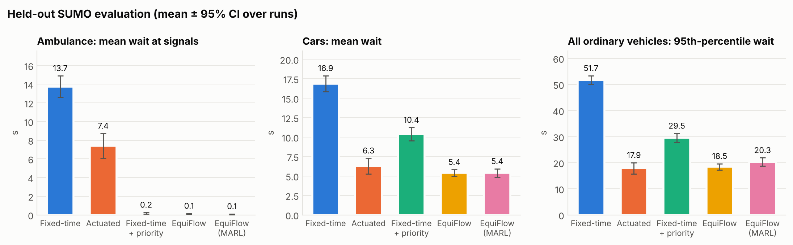
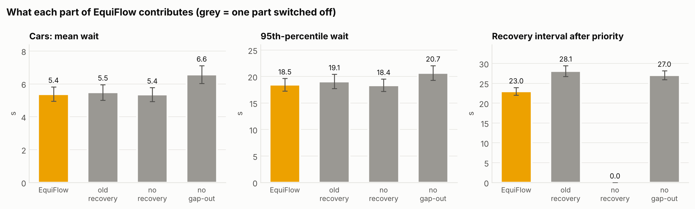

# EquiFlow: results, failure cases and limitations

Everything here is produced by scripts in the repository. Numbers come from the CSV files named in each
section; nothing was typed in by hand. Regenerate with:

```bash
cd sumo
python run_matrix.py        # 1 000 one-hour SUMO runs (~45 min on 2 cores) -> results/heldout/
python aggregate.py         # statistics -> results/heldout/RESULTS_TABLES.md (all tables, more than shown here)
python run_robustness.py --fp 0 0.02 0.05 0.1 0.2 0.4 --seed 6
python benchmark.py         # controller timing
python make_plots.py        # docs/figures/
python latex_tables.py      # docs/latex/results_tables.tex
cd ../Projects
python score_tracking.py    # tracking on the Islamabad videos
```

## 1. Set-up

- **Networks:** the 6 signalised Islamabad junction types in `sumo/` (cross, T, five-way, six-way, sector grid,
  diamond), each at 4 demand levels (low, medium, high, asymmetric), one simulated hour each.
- **Seeds 6–10, held out.** The MARL controller was trained on seeds 1–5, so no evaluation run was seen in
  training (mid-report Section 7.5). Every controller runs the same 120 network × demand × seed combinations.
- **Controllers:** SUMO fixed-time; SUMO actuated (the strong adaptive baseline); fixed-time + ambulance
  priority without recovery (the "emergency-only preemption" baseline of Section 7.2); EquiFlow; EquiFlow
  with the MARL base controller; and ablations (no recovery, no gap-out, no green corridor, old recovery rule).
- **Ambulances** are detected by a virtual camera per approach with the real 5-of-8 vote; priority starts only
  after confirmation.
- **Statistics:** mean ± 95% confidence interval over runs. "Paired" comparisons subtract two controllers on
  the *same* network, demand and seed, which removes the large differences between networks.

Source: `sumo/results/heldout/` (`summary_stats.csv`, `paired.csv`, `by_scenario.csv`, `marl_heldout.csv`,
`run_manifest.csv` holds the configuration and software versions behind every run).

## 2. Main results



| | Fixed-time | Actuated | Fixed + priority | **EquiFlow** | EquiFlow (MARL) |
|---|---|---|---|---|---|
| Ambulance mean wait (s) | 13.75 ± 1.16 | 7.42 ± 1.31 | 0.19 ± 0.08 | **0.10 ± 0.06** | 0.07 ± 0.04 |
| Ambulance travel time (s) | 59.14 ± 2.42 | 52.75 ± 2.40 | 43.11 ± 2.19 | **42.68 ± 2.20** | 42.72 ± 2.21 |
| Car mean wait (s) | 16.87 ± 1.02 | 6.28 ± 1.01 | 10.38 ± 0.86 | **5.38 ± 0.44** | 5.39 ± 0.54 |
| 95th-percentile wait (s) | 51.71 ± 1.61 | 17.87 ± 2.13 | 29.55 ± 1.69 | **18.45 ± 1.18** | 20.31 ± 1.58 |
| Longest single wait (s) | 72.17 ± 3.72 | 36.71 ± 4.45 | 58.98 ± 5.08 | **39.44 ± 3.11** | 42.67 ± 3.50 |
| Worst approach, mean wait (s) | 21.98 ± 1.37 | 7.95 ± 1.10 | 13.49 ± 1.02 | **6.92 ± 0.52** | 6.97 ± 0.61 |
| Jain index across approaches | 0.915 | 0.888 | 0.903 | **0.909** | 0.896 |
| Detection to green (s) | – | – | 2.58 | **2.41** | 2.51 |
| Runs | 120 | 120 | 120 | 120 | 120 |

**What this shows**

1. **Ambulances practically stop waiting at signals**: 13.8 s → 0.1 s against fixed-time and 7.4 s → 0.1 s
   against actuated; ambulance travel time drops by 16.5 s (28%) against fixed-time and 10.1 s (19%)
   against actuated. EquiFlow is faster than actuated for ambulances in 99% of paired runs.
2. **Ordinary traffic does not pay for it on average.** Car wait is 11.5 s lower than fixed-time (100% of
   paired runs) and 5.0 s lower than fixed-time with simple priority. Against SUMO's actuated plan the
   paired mean is 0.90 ± 0.74 s lower (significant), **but EquiFlow is better in only 38% of the paired runs**:
   it wins big in some runs (low demand, the multi-junction networks) and loses a little in most others.
   The 95th-percentile and longest waits are statistically indistinguishable from actuated
   (+0.6 ± 1.3 s and +2.7 ± 3.3 s).
3. **Fairness across approaches** (Jain index) is significantly better than actuated (+0.021, better in 73%
   of runs) and the worst-served approach waits 6.9 s instead of 8.0 s. Against fixed-time the Jain index is
   equal (fixed-time spreads waiting evenly by design, but at three times the level).
4. Under **heavy demand** EquiFlow's car-wait advantage over actuated shrinks (6.92 vs 7.25 s) and its
   95th-percentile wait is higher (22.44 vs 20.76 s). See `fig_by_demand.png` and `by_scenario.csv`.


## 3. What each part contributes (ablations, paired on identical runs)



| Switched off | Car mean wait | 95th-percentile wait | Longest wait | Ambulance | Verdict |
|---|---|---|---|---|---|
| **Gap-out** (FR-07) | +1.18 ± 0.16 s worse | +2.22 s worse | +3.10 s worse | no change | **Clear benefit**, better in 97% of runs |
| **Fair recovery** | +0.03 ± 0.09 s (n.s.) | +0.08 s (n.s.) | +0.61 s (n.s.) | no change | **No measurable effect** |
| **Green corridor** (2 multi-junction networks) | −0.16 s *better* without | −0.54 s *better* without | −8.2 ± 3.9 s *better* without | 0.21 ± 0.16 s faster *with* | **Small cost, tiny benefit** |

"Worse/better" = what happens when the part is removed. n.s. = 95% CI includes zero.

- **Gap-out** (end an empty green early, added in Iteration 2) is the single biggest improvement to ordinary
  traffic, and it is what moved EquiFlow from behind actuated (7.6 s vs 6.5 s in the earlier, unmatched
  runs) to level with or ahead of it.
- **Fair recovery does not measurably help in these scenarios.** The first rule (every delayed approach gets
  a fixed 15 s green plus extra) was slightly *harmful*: longest wait 2.3 ± 1.7 s worse and recovery 5 s
  longer than the queue-sized rule that replaced it. The current rule (green sized to each queue at 2 s per
  vehicle, empty approaches skipped) is no worse than having no recovery at all, but not better either. The
  likely reasons: priority intervals are short (about 12–15 s, roughly 14–35 ambulances per hour per
  network), the adaptive base controller already serves the longest-waiting and busiest approach next, and
  the 90 s maximum-wait guard prevents starvation anyway. The metrics are also network-wide, which dilutes
  an effect that only touches the vehicles caught by a priority interval. **This is the main open research
  question for FYP-2** (see Section 8).
- **The green corridor** gets ambulances through 0.21 s faster on the sector grid and diamond, but raises
  the longest wait of ordinary vehicles by 8.2 s because downstream junctions clear early. With junctions
  this close, local priority alone is nearly as fast. Worth keeping as an option, not as a default claim.

## 4. MARL controller


On the held-out seeds MARL ties the hand-tuned adaptive controller on car wait (0.00 ± 0.17 s) and ambulance
wait, but has a **higher 95th-percentile wait (+1.85 ± 0.56 s)** and longest wait (+3.2 s), and a lower Jain
index (−0.014). It is the same on network/demand combinations it was trained on and ones it never saw
(`marl_heldout.csv`), so it is not over-fitted to its training scenarios; it simply has not learned to beat
the heuristic. Training was 55 short episodes; the per-episode wait in `fig_marl_training.png` swings
because episodes rotate between networks of very different difficulty, and the 5-episode average flattens
after about episode 10. Longer training, a reward that weighs the 95th-percentile wait more, and more
episodes per network are the next steps.

## 5. Robustness to camera errors


Source: `sumo/results/robustness.csv` (cross junction and sector grid, heavy traffic, seed 6; the earlier sweep
made before gap-out is kept as `robustness_before_gapout.csv`).

- Up to **10% of frames wrongly scored as ambulance: zero false priority runs.** The 5-of-8 vote filters them.
- At **20%**: 6–33 false priority runs per hour; car wait rises by up to 0.9 s.
- At **40%**: hundreds per hour (the sector grid: car wait 6.6 → 11.1 s). The system needs a classifier
  whose per-frame false-alarm rate on real traffic stays well below 20%. The validation split shows 0.65%
  (18 of 2 755), so there is a wide margin, but real video (test5 below) is harder than crops.
- **Missed frames barely matter:** even with 85% of frames missed, ambulances wait at most 1.8 s, because
  the vote only needs 5 hits among the last 8 *processed* frames over the ~10 s an ambulance spends in view.

## 6. Tracking on the real Islamabad videos

Source: `Projects/tracking_out/tracking_scores.md` (`score_tracking.py`, events from `track_pipeline.py`).

| | |
|---|---|
| Videos processed | 8 of 13 labelled (test6, test7, test8, test11, v2 not run yet) |
| Ambulance passes detected | **6 of 7** (5 of 7 if a confirmation up to 1 s before the hand-labelled start is not allowed) |
| Confirmation latency | mean 0.26 s, max 0.68 s after the ambulance appears |
| False confirmations | 13 in total: **9 in test5**, 2 in v1, 1 in test9, 1 in test4 |

## 7. Failure cases (analysis)

| # | Failure | Evidence | Cause (likely) | What to do |
|---|---|---|---|---|
| F1 | Missed ambulance (test12, window 0–2 s) | `tracking_scores.md` | Ambulance visible only 2 s at the start of the clip: fewer than 5 confident frames before it leaves | Lower K for short tracks near the frame edge, or a higher frame rate |
| F2 | 9 false events in test5 | `tracking_out/test5/events.csv`: mean p 0.06–0.93 | Either an ambulance-like vehicle (white van, rescue vehicle) the classifier was not trained on, or test5 actually contains an ambulance and the label is wrong (most tracks head the same way at ~−100°) | **Check the test5 ground truth first.** If it is a look-alike, add its crops to `other_vehicle` |
| F3 | Early confirmations (test12 at 77.0 s, window starts 78 s) | `tracking_scores.md` | Hand-labelled windows are approximate | Label windows from the first frame the vehicle is visible |
| F4 | Classifier recall 91% (39 of 433 val ambulances missed) | mid-report Table 7.2 | 96 px crops lose markings; ~17% ambulances in train | `eval_detector.py --target-recall 0.95` (threshold), `train_cls_v5.py` (128 px, oversampling, larger model) |
| F5 | Many false priority runs at ≥ 20% per-frame false alarms | `robustness.csv` | Vote window too permissive for very noisy input | Keep per-frame FP well below 20%; raise K or mean_min for noisy cameras |
| F6 | Under heavy demand EquiFlow's p95 wait exceeds actuated | `by_scenario.csv` | Adaptive greens are capped at 30 s and decided once per green; actuated extends greens vehicle by vehicle | Per-vehicle extension (actuated-style) in the adaptive base controller |
| F7 | Corridor raises longest wait by 8 s | `paired.csv` | Downstream junctions clear 25 s ahead even when the ambulance would have been served locally | Shorter corridor_eta_s, or corridor only when local priority would be late |
| F8 | Fair recovery has no measurable effect | `paired.csv` | See Section 3 | Approach-level metric for the vehicles actually delayed; scenarios with longer / more frequent priority |
| F9 | Stale / replayed detections | `tests/test_requirements.py` (TC-03) | Network delay or replayed messages | Handled: events older than 2 s are rejected and logged |

## 8. Limitations (state these in the report)

- **Simulation only.** No real signal is controlled; SUMO's driver model, the hand-built networks and the
  generated demand decide the absolute numbers.
- **The SUMO cameras are virtual**: ambulances are known exactly and their classifier scores are simulated
  (with the error sweep in Section 5). The real camera pipeline and the SUMO evaluation are joined through
  the same controller and the same voting rule, not through real video of the simulated junctions.
- **Network-wide fairness metrics** dilute the effect of priority on the few approaches it interrupts.
- **The classifier has not been evaluated on the test split yet** (needs the dataset on the DELL machine; see
  `ITERATION2.md`). All detector numbers so far are validation-split, where the checkpoint was chosen.
- **Tracking** was scored on 8 short clips with 7 ambulance passes: far too few for a reliable recall figure.
- The camera junction's queue is a vehicle count inside a hand-drawn zone (`zones:` in the config), not a
  calibrated lane-level queue length.
- No authentication by default (`server.api_key` turns it on); fine for a local demo only.

## 9. Performance

Source: `sumo/results/performance.md`.

- Signal controller: one tick takes about **1 µs** (adaptive) and a MARL decision about **24 µs** (p99 62 µs),
  against a 100 000 µs tick budget in the live backend.
- SUMO evaluation: about **1 300–1 400 simulated seconds per wall-clock second** per run, so one simulated hour
  takes about 3 s (two runs in parallel on two cores).
- Detector latency: measured by `Projects/eval_detector.py` on the target machine (not run yet). In a CPU-only
  smoke test (2 cores, synthetic 1080p frame) the detector took 470 ms per frame at imgsz 1280 and the classifier
  1.1 ms per crop, so the live pipeline needs a GPU for real time.
